# Lab 7: Docker Containers and Images

GitHub username: sidraliaqat  
Host: ubuntu

This lab covers installing Docker, running PostgreSQL and NGINX containers, managing containers and images, and saving a changed NGINX container as a new image. Screenshots are in the `screenshots/` folder.

## Task 1: Install Docker and Docker Compose

### Version checks

Docker 29.1.3 and Docker Compose v5.7.1 are installed.

```
docker --version
docker compose version
```

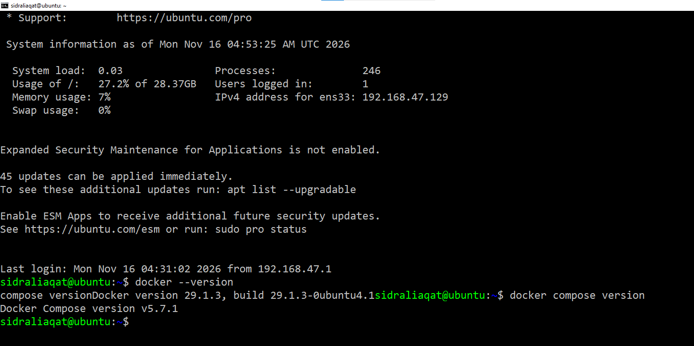

## Task 2: Run Two PostgreSQL Versions in Docker

### Run without a password

Running postgres:9.6 with no password fails, because POSTGRES_PASSWORD is required to initialize a new database.

```
docker pull postgres:9.6
docker run postgres:9.6
```

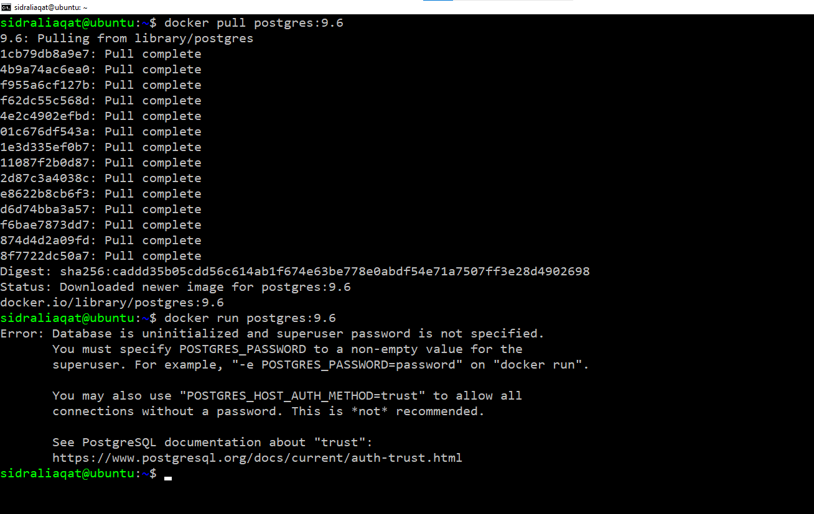

### PostgreSQL 9.6 running

With the password set and -d, the container runs in the background.

```
docker run -d -e POSTGRES_PASSWORD=password postgres:9.6
docker ps
```

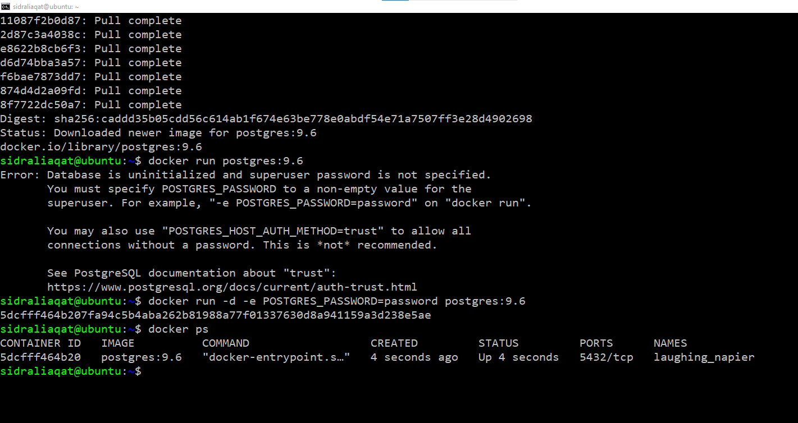

### Both versions running

A second container with postgres:10.10 runs next to the first.

```
docker run -d -e POSTGRES_PASSWORD=password postgres:10.10
docker ps
```

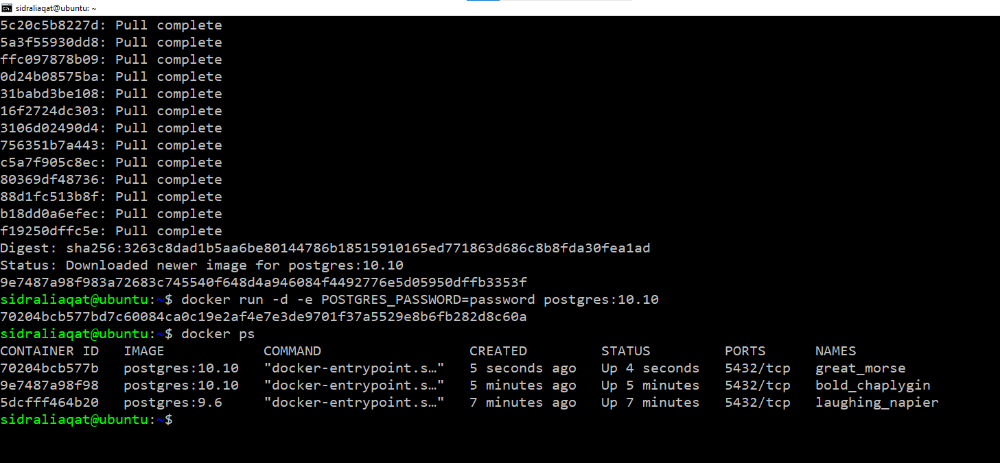

## Task 3: Inspect Docker and Manage Containers and Images

### Docker installation details

Shows the Docker server details.

```
docker info
```

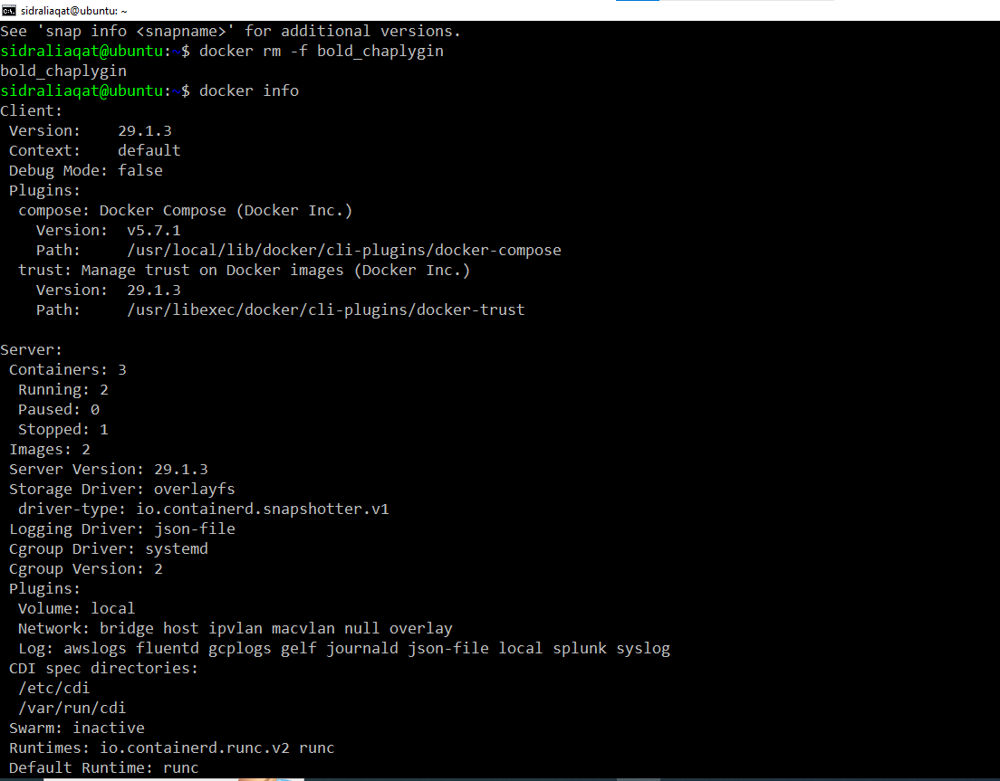

### Search Docker Hub

The official ubuntu image is the first result.

```
docker search ubuntu
```

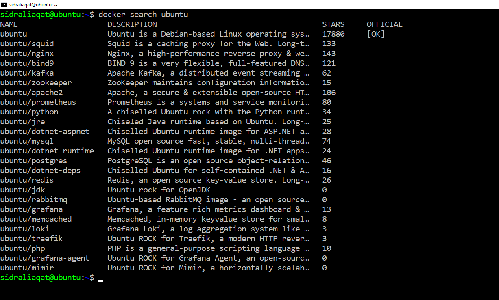

### Running and stopped containers

The Ubuntu container exits right after it starts because bash has no interactive session. It is missing from docker ps and shows as Exited in docker ps -a.

```
docker images
docker run -d ubuntu
docker ps
docker ps -a
```

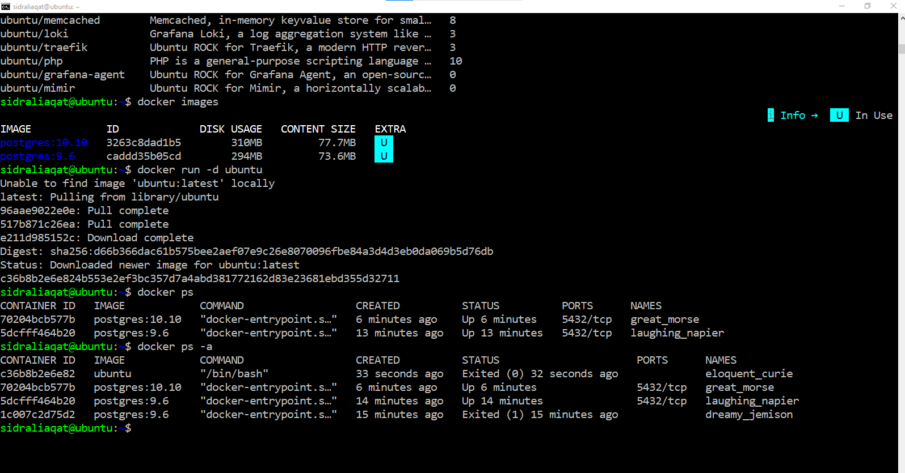

### Clean up PostgreSQL 9.6

The container is restarted, stopped and removed, then the image tag is removed. The container has to go first, otherwise docker rmi fails because the image is in use. postgres:10.10 keeps running.

```
docker restart romantic_easley
docker stop romantic_easley
docker rm romantic_easley
docker rmi postgres:9.6
```

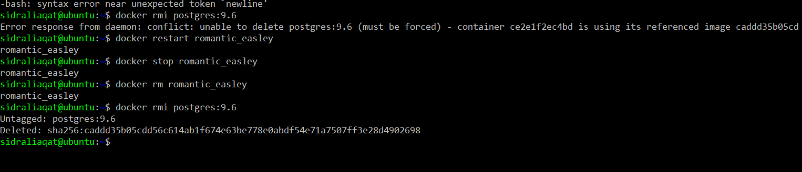

## Task 4: Run Two NGINX Containers on Different Ports

### Start both containers

nginx-latest runs on host port 6001 and nginx-older (tag 1.30.6) on host port 6002. Both listen on port 80 inside Docker.

```
docker run -dit -p 6001:80 --name nginx-latest nginx
docker run -d -p 6002:80 --name nginx-older nginx:1.30.6
```

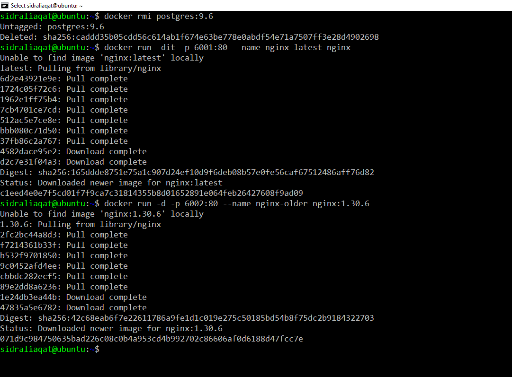

### Welcome page on port 6001

Default NGINX page from nginx-latest.

```
http://192.168.47.129:6001
```

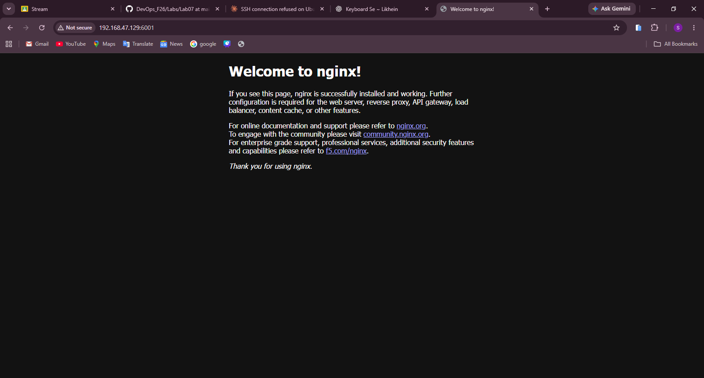

### Welcome page on port 6002

Default NGINX page from nginx-older.

```
http://192.168.47.129:6002
```

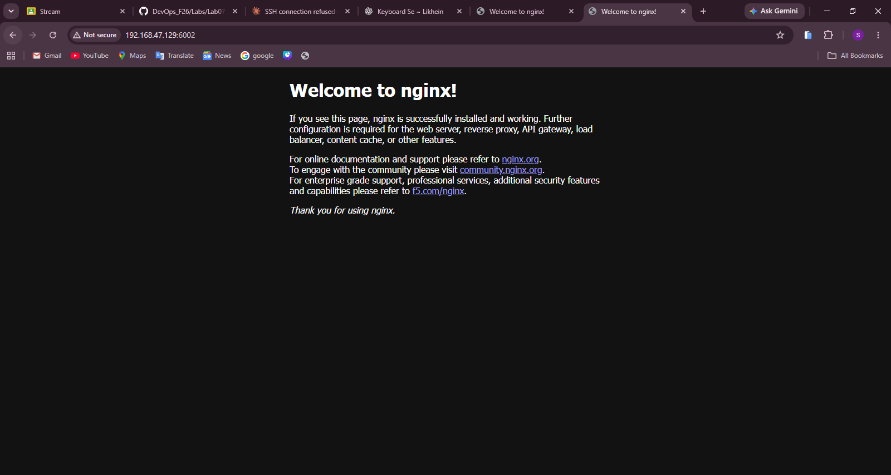

### Container logs

The access log shows the browser request (GET / with status 200). The favicon.ico 404 is normal.

```
docker logs nginx-latest
```

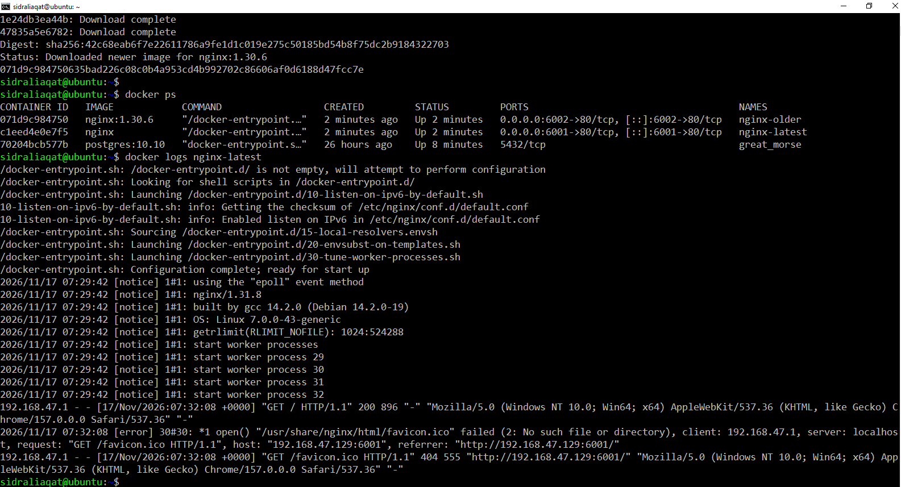

## Task 5: Work Inside a Container and Save a New Image

### Attach and detach

docker attach connects to the main NGINX process. Refreshing the page added new request lines. Ctrl+P then Ctrl+Q detached without stopping the container.

```
docker attach nginx-latest
```

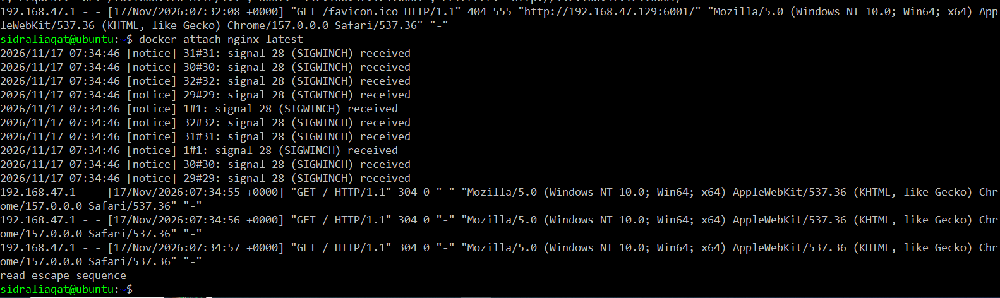

### Shell inside the container

A separate shell was opened with docker exec. newfile.html and oldfile.html were created, oldfile.html was removed, and printenv listed the environment.

```
docker exec -it nginx-latest /bin/sh
ls /
touch /usr/share/nginx/html/newfile.html
touch /usr/share/nginx/html/oldfile.html
rm /usr/share/nginx/html/oldfile.html
printenv
exit
```

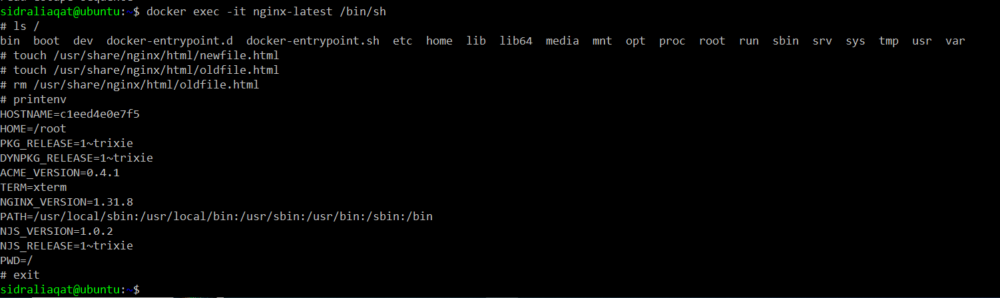

### Filesystem changes

A means added and C means changed. newfile.html is listed as added. oldfile.html is not listed because it was created and removed in the same session.

```
docker diff nginx-latest
```


### Inspect the container

The State block shows Status running and Running true.

```
docker inspect nginx-latest
```

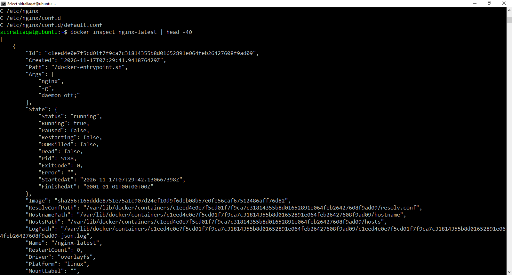

### Save a new image

The changed container is saved as the local image nginx:myimage.

```
docker commit nginx-latest nginx:myimage
```

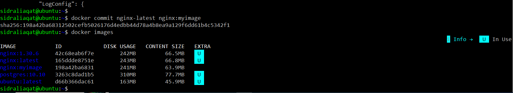

## Summary

- Docker 29.1.3 and Docker Compose v5.7.1 were checked.
- The missing-password error was shown, then PostgreSQL 9.6 and 10.10 ran together.
- docker info and docker search ubuntu were captured, and the exited Ubuntu container was found with docker ps -a.
- PostgreSQL 9.6 was restarted, stopped and removed, then its image tag was removed.
- Two NGINX containers ran on ports 6001 and 6002 and the logs showed the browser request.
- After changing files in a separate shell, docker diff showed the added file and docker commit created nginx:myimage.
